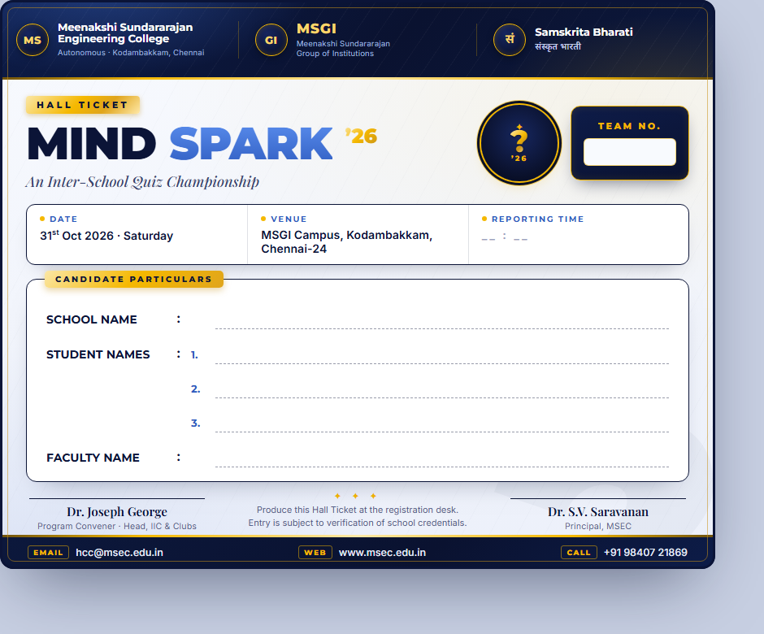

<div align="center">

# Mind Spark '26 — Hall Ticket Design

### Print-style admit pass for an inter-school quiz championship at MSEC




</div>

---

## 📖 Overview

This repository contains the **official hall ticket (admit pass) design** for
**Mind Spark '26 — An Inter-School Quiz Championship**, hosted by
**Meenakshi Sundararajan Engineering College (MSEC)**, Kodambakkam, Chennai, in association with
the Meenakshi Sundararajan Group of Institutions (MSGI) and Samskrita Bharati.

It is a **design-tool artboard exported as standalone HTML/CSS** — a premium navy-and-gold,
print-ready admit pass with fill-in fields for the registration desk. Treat it as a
**reference mockup**: the exact colors, spacing, radii and type values live in the inline
styles, ready to be replicated faithfully in any production component system.

## 🎨 Design Anatomy

- **Masthead** — three institutional identities (MSEC · MSGI · Samskrita Bharati) on navy with gold seals
- **Title block** — gold "HALL TICKET" chip, the **MIND SPARK '26** wordmark with quiz-bulb emblem, and the championship subtitle
- **TEAM NO. box** — prominent gold-framed slot for the team number
- **Event facts strip** — DATE (31<sup>st</sup> Oct 2026 · Saturday), VENUE (MSGI Campus, Kodambakkam, Chennai-24), REPORTING TIME (blank to fill)
- **Candidate particulars card** — school name, three student names and faculty mentor on dashed fill-in rules
- **Signature block** — Program Convener (Dr. Joseph George, Head, IIC & Clubs) and Principal (Dr. S.V. Saravanan), with the registration-desk instruction between them
- **Contact footer** — email, web and phone chips on navy
- **Editable fields** — entry boxes and dashed lines are fillable straight in the browser before printing

## 📁 Contents

| File | Purpose |
|---|---|
| `Main.dc.html` | The artboard — a Design Component (`<x-dc>`) with all design values in its inline styles |
| `build_html.py` | Regenerates `Main.dc.html`: base64-embeds the logos (Pillow, LANCZOS downscale) and writes the full standalone page |
| `support.js` | Generated design-component runtime (**do not edit**) |
| `_preview.png` | Full hall ticket preview |
| `header_card_preview.png`, `preview_title_row.png` | Section close-ups |
| `mseclogo.png`, `msgi-logo.png`, `sb_logo.png`, `75years.png` (+ variants), `quiz-logo-source.jpeg`, `bulb-logo.png` | Logo assets used in the design |

## 🚀 Viewing & Regenerating

**View the committed artboard** — serve the folder over HTTP (browsers block the runtime
scripts over `file://`):

```bash
python -m http.server
# open http://localhost:8000/Main.dc.html
```

> Note: the artboard renders through the design-tool runtime — `support.js` expects the React
> globals from `vendor/react*.js`, which are not committed here. Supply the React UMD builds in
> `vendor/`, or regenerate with the build script below.

**Regenerate a self-contained page** (embeds every logo as base64):

```bash
pip install pillow
python build_html.py     # rewrites Main.dc.html with embedded assets
```

## 🖨️ Using the Design

- The marked entry boxes and dashed rules are the **fill-in fields** — complete them in the
  browser, then print to PDF or paper (the layout is sized for a clean single-page pass)
- When implementing in production, **replicate the values** (colors `#0B1437` navy / `#F5B800`
  gold, Inter type, radii, shadows) in your own components and styling system rather than
  copying the export markup wholesale

## 👤 Author

**Prince Kumar** — [@princekumar-dev](https://github.com/princekumar-dev)

Built for the **MSEC** Mind Spark '26 quiz championship — Chennai, Tamil Nadu, India.

---

<div align="center">
<sub><b>Mind Spark '26</b> — every great team starts with a hall ticket.</sub>
</div>
